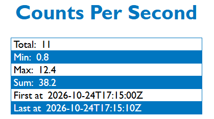

# Radiation Counts Per Second
Designing a solution without access to the target device has been challenging. I decided to build something I could use in my own development workflow: an application that accepts arguments through command-line commands and displays the results in a web page. I prefer using the command line when developing and testing, so this approach reflects how I'd naturally work with the tool myself.

I'm not familiar with radiation data, so I asked Gemini AI to generate an array of dummy CPS (counts per second) data with timestamps for testing. Since I don't have access to the actual device, I'm assuming it can execute the commands below, display an HTML file, and periodically refresh the page. I'm developing on Windows, so the commands may differ slightly on Linux or macOS.

## View app.html for demo

During my technical interview, I received feedback on my code and realized I had made several assumptions about how the device would work. It was helpful to clarify some of my questions and better understand the actual requirements.

Initially, I assumed the raw data needed to be stored. After seeing the device in action, I quickly realized that a database wasn't necessary for this project. The goal was simply to display statistics as the data comes in, rather than persist historical readings.

My original implementation saved incoming readings to a CSV file and then calculated statistics from those stored records. I reworked the approach so that statistics are now calculated as each reading arrives and maintained temporarily in memory.

I'm still using the same dummy data, but I've implemented a one-second buffer to simulate the actual device's data stream. The page now updates automatically without requiring a manual refresh.

I also added a small graph to visualize the incoming readings and make it easier to see changes in radiation levels.

How to view demo: `start .\app.html`

## Commands

### Add CPS reading
`node .\cmd\addCpsReading.js CPS_NUMBER`

### Generate file for HTML page to display
`node .\cmd\makeCpsStats.js`

### Reset Statistics
`node .\cmd\clearCpsReadingsAndStats.js`

### Add reading, then generate file
`node .\cmd\addCpsReading.js CPS_NUMBER | node .\cmd\makeCpsStats.js`

### View fresh demo
`cp .\test\dummyCpsData.csv .\data\cpsReadings.csv | node .\cmd\makeCpsStats.js | start .\index.html`

### View html file in browser
- Windows: `start .\index.html`
- Mac: `open index.html`
- Linux... I'm not sure, I haven't tried.

## Data Files
- raw data: cpsReadings.csv (timestamp, cps)
- formatted stats: data/cpsStatsVariable.js
- dummy data for testing: test/dummyCpsData.csv

## Testing
Do `cp .\test\dummyCpsData.csv .\data\cpsReadings.csv` to manually test.

### Run automated tests:
- Update snapshots: `node --test --test-update-snapshots`
- Run tests: `node --test`
